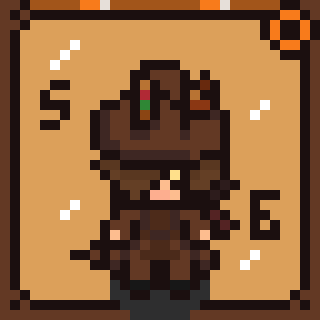

# ClockGears Engine

  

<h3 align="center">Next-Generation RPG Game Creation Engine</h3>

<b>Creado y Diseñado por Kris'ZtS</b>

---

## ⚙️ Descripción General

**ClockGears Engine** es un motor de videojuegos de nueva generación orientado al desarrollo ágil, robusto y sin fricción de videojuegos, especialmente RPGs, bajo el paradigma intuitivo de **RPG Maker MZ** pero impulsado internamente por una arquitectura moderna de renderizado y física en C++.

Diseñado y conceptualizado por **Kris'ZtS**, ClockGears Engine oculta la complejidad técnica de los árboles de nodos tradicionales tras un flujo de trabajo centrado en **Mapas, Capas y Eventos Interactivos**.

---

## 🚀 Características Principales

### 1. Paradigma Visual RPG Maker MZ
* **Barra Superior Masiva de Acceso Rápido**:
  * `Modo Tiles` / `Modo Eventos`
  * Selector Rápido de Mapas y Capas (Suelo, Decoración, Objetos, Techo)
  * Botones Visuales de Deshacer (`Ctrl+Z`) y Rehacer (`Ctrl+Y`)
  * Selector de Actor / Personaje Principal de Grupo
  * Selector estricto de cuadrícula: `16x16`, `32x32`, `48x48`
  * Botón `Salir de la casilla` (Alternar entre Snap to Grid y Transformación Libre)
  * `Importar imágenes` directo al mapa

### 2. Creación de Eventos Zero-Code
* Sistema completo de eventos sin requerir una sola línea de código:
  * Diálogos enriquecidos con retratos (Face Graphics), marcos de ventana (Normal, Atenuado, Transparente) y posiciones (Abajo, Centro, Arriba).
  * Control de Interruptores (Switches) y Variables con operaciones aritméticas y aleatorias.
  * Rutas de Movimiento Autónomo (Fijo, Aleatorio, Seguir Jugador, Rutas Personalizadas).
  * Teletransporte entre mapas y transiciones con fundido.
  * Procesamiento de batallas por turnos y recompensas.
* **Pestaña 'Code' Opcional**: Para usuarios avanzados que deseen programar scripts puros, su uso es 100% opcional.

### 3. Base de Datos RPG Completa
* Gestores visuales integrados para:
  * **Clases**: Curvas de EXP, progresión de 8 estadísticas y habilidades aprendibles.
  * **Enemigos & Tropas**: Estadísticas de combate, recompensas de EXP/Oro, botines y patrones de IA.
  * **Habilidades**: Fórmulas de daño, costes de PM/TP, ámbito y animaciones.
  * **Objetos**: Consumibles, efectos curativos y precios.
  * **Armas & Armaduras**: Tipos de equipo, bonificaciones y rasgos elementales.
  * **Estados**: Estados alterados, restricciones de turno y daño por veneno (slip damage).
* Botones prominentes para **Importar** y **Exportar** Sprites, Partículas y Audios.

### 4. Herramientas de Automatización
* Pestaña principal con presets listos para arrastrar y soltar:
  * Movimiento del jugador en 2, 4 y 8 direcciones con auto-vinculación de teclas (`InputMap`).
  * Cámara suave de seguimiento RPG.
  * PNJ autónomo errante.
  * Cofres de botín interactivos y puertas de teletransporte.
  * Sistema de guardado y carga persistente.

### 5. Diseñador WYSIWYG de UI y HUD
* Lienzo interactivo Drag & Drop para diseñar interfaces sin código:
  * Barras de vida (HP) y mana (MP).
  * Ventanas de diálogo personalizables.
  * Menús principales de pausa.
  * Contadores de oro y minimapas HUD.

### 6. Personalización del Editor
* **3 Temas (Skins)**:
  * `Retro Pixelart`: Bordes nítidos de píxel, contraste alto y estética clásica de 16 bits.
  * `Dark OLED`: Fondos negros puros de bajo consumo y texto de alto contraste.
  * `Classic JRPG Blue`: Gradientes azules reales inspirados en los RPGs legendarios de consola.
* **Paleta de 8 Colores de Acento**: Oro ClockGears, Carmesí Rubí, Clásico JRPG Azul, Verde Esmeralda, Púrpura Amatista, Cian Neón, Naranja Atardecer y Rosa Sakura.

### 7. Exportación Simplificada (1-2 Clics)
* Exportación directa para:
  * **PC (Windows / Linux)**: Ejecutable autónomo listo para distribuir.
  * **Android**: Generación automática de APK y gestión de Keystore en segundo plano.
  * **Consolas**: Paquetes base y manifiestos listos para kits de desarrollo.
* Todos los ejecutables finales y compilaciones se centralizan directamente en la carpeta raíz `ClockGears Engine/builds/`.

---

## 👥 Créditos & Autoría

* **Creador & Arquitecto Principal del Motor**: **Kris'ZtS**
* **Iconografía & Assets**: `C:\Proyectos\NEW MOTOR\ICONO`
* **Derechos de Autor**: © 2026 Kris'ZtS. Todos los derechos reservados.
